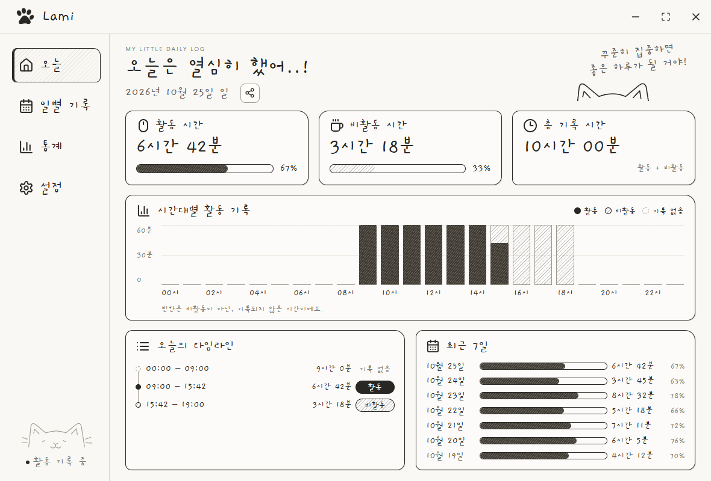
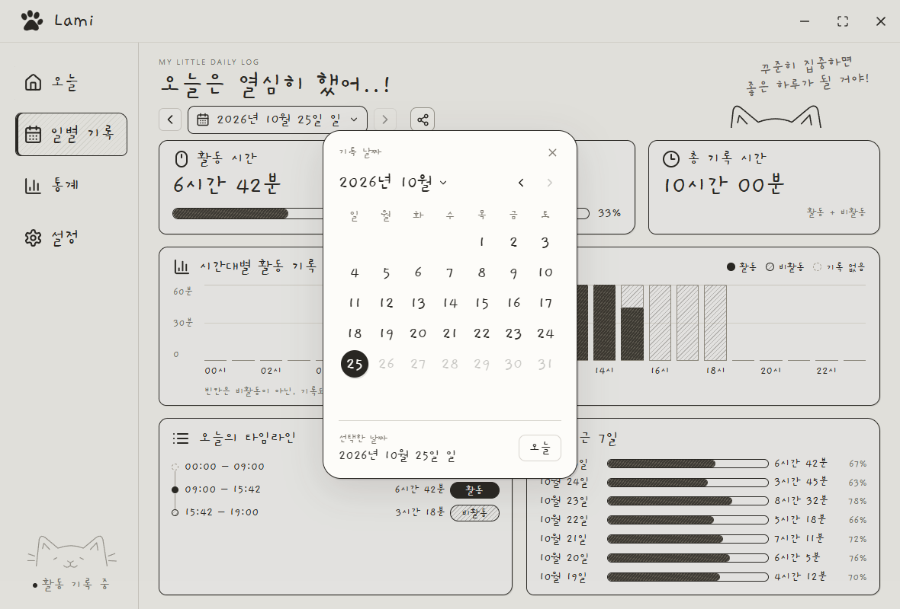
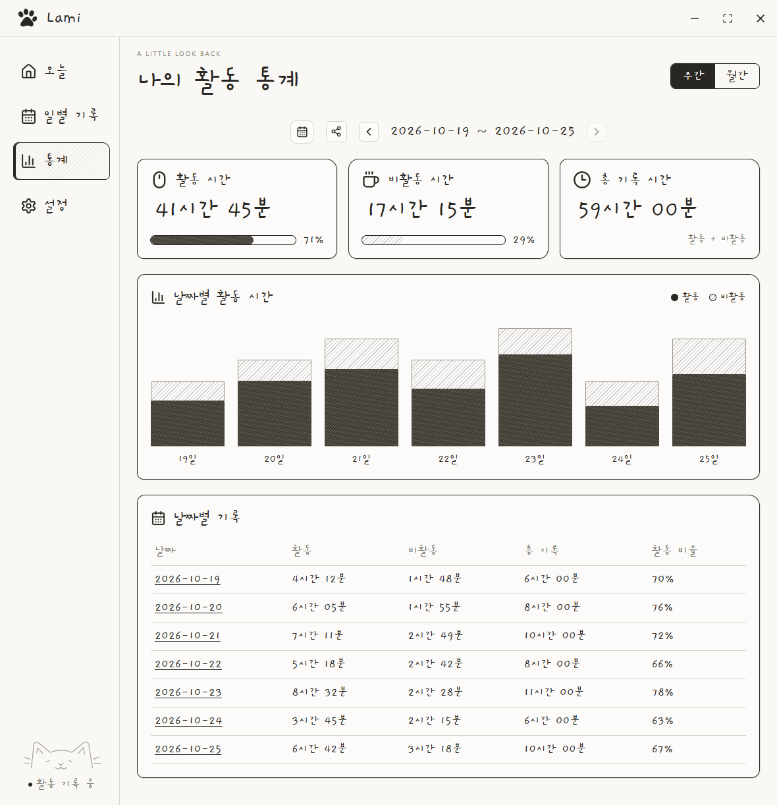
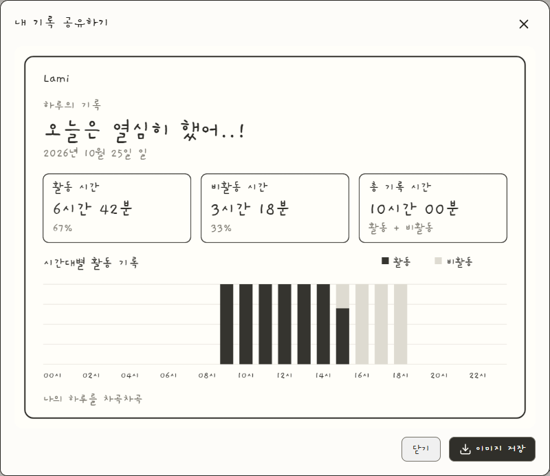

# Lami

Windows에서 활동·비활동 시간을 기록하고 일별·주간·월간 통계를 확인하는 앱입니다.

설치 파일과 업데이트 소식은 이 저장소의 Releases에서 배포합니다. 이 저장소에는 프로그램 소스나 사용자 활동 기록을 포함하지 않습니다.

- Windows 10/11 x64
- 기본 비활동 기준 3분
- 트레이에서 기록하고 Windows 로그인 시 자동 실행
- 일별·주간·월간 기록의 PNG 공유 카드
- 새 버전 안내와 설치 후 변경 내용 표시

사용자 기록은 사용자 PC에 저장됩니다. 업데이트 확인에는 앱 버전과 공개 배포 정보만 사용합니다.

[최신 설치 파일 다운로드](https://github.com/JUNHOCHOI0309/Lami-releases/releases/latest)

## 사용 화면

예시 활동 기록으로 캡처한 Lami v0.1.10 화면입니다.

### 오늘의 기록

활동·비활동 시간과 비율, 시간대별 그래프, 최근 7일의 기록을 확인합니다.

### 일별 기록과 날짜 선택

캘린더에서 날짜를 골라 지난 기록을 조회합니다.

### 주간 통계

기간 합계와 날짜별 활동·비활동 시간을 그래프와 표로 비교합니다. 월간으로도 전환할 수 있습니다.

### 기록 공유

공유 아이콘을 누르면 PNG 카드를 미리 보고 이미지로 저장할 수 있습니다.

